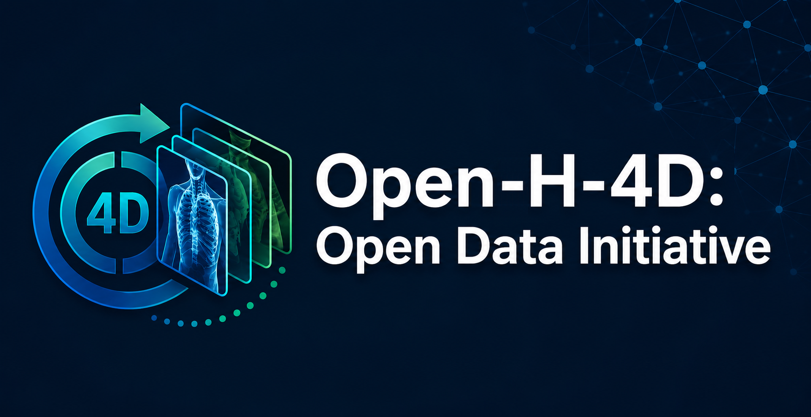

<div align="center">



# Open-H-4D

[](LICENSE)
[](https://openmdw.ai/)

*A collaborative collection of 4D cardiac and respiratory imaging, for training foundation models of physiological motion.*

</div>

---

## About

Open-H-4D is an [Open-H.org](https://open-h.org) initiative to collect **20,000
total cases** of cardiac and/or respiratory motion, including real patient cases
and simulated cases. Building on Open-H-Embodiment, it aligns leading institutions
around a single openly licensed corpus. 4D CT, MRI and ultrasound images are
prioritized; derived models, simulated motion data and other relevant data are
also accepted through an open proposal category.

The collected datasets will be freely available for academic and commercial use,
and used to train and validate physics-informed and generative AI models of
physiological motion. Beyond motion modelling, the data suits detecting imaging
biomarkers that inform patient-specific physics parameters, training diagnostic
models that incorporate physiological data, and simulating clinical signals such
as EKG and spirometry as well as motion artifacts in 3D images.

NVIDIA sponsors Open-H-4D by pre-processing all submissions and enabling free,
open access to the dataset, foundation model weights and training code on project
completion.

Released on Hugging Face under the [**OpenMDW**](https://openmdw.ai/) license.

## This repository

Tooling for preparing and checking an Open-H-4D contribution, and the normative
specification of what a submission looks like.

| | |
|---|---|
| [`skills/open-h-4d-shared/layout-spec.md`](skills/open-h-4d-shared/layout-spec.md) | **The submission layout specification.** Start here. |
| [`skills/`](skills/) | Agent skills for organizing, converting, verifying and evaluating submissions |
| [`src/openh4d/`](src/openh4d/) | The Python package every skill invokes |
| [`examples/`](examples/) | Three worked examples that each build a complete submission |

## How to participate

1. **Review the CFP** — [Call for Proposals](assets/Open-H-4D_Call_For_Proposals.pdf)
   for scope, eligibility, data requirements and review criteria.
2. **Submit a proposal** — describing the data you would contribute, per CFP §8,
   via the [submission form](https://forms.gle/Y9pUAHhG7xYCWDoD7). Pre-proposals
   are welcome for early feedback on data relevance, open-category contributions
   and approval or licensing feasibility. Full proposals are PDF, at most 5 pages
   excluding CVs, and propose at least 20 cases for case-based datasets.
3. **Prepare your data** — using the tooling here. The
   [layout specification](skills/open-h-4d-shared/layout-spec.md) is the contract.
4. **Co-author the release** — contributing teams are named co-authors on both
   the dataset publication and the follow-up foundation-model publication, receive
   early access to evaluation checkpoints and the dataset itself, and are
   recognized in the joint releases and public announcements.

## Scope

Contributions may be proposed for either or both task groups:

- **cardiac motion**
- **lung respiratory motion**

in the following categories:

- **Images** (preferred) — time-resolved 3D CT, MRI or ultrasound sequences with
  relevant patient metadata.
- **Derived models** — segmentations, anatomical surfaces or meshes, and motion or
  deformation models; may be proposed when source images cannot be shared,
  provided the contributor holds the required rights and approvals.
- **Simulated motion data** — time-resolved motion from computational models,
  clearly distinguished from measured motion.
- **Open category** — other relevant data, such as paired 3D CT and ultrasound,
  complementary measurements, other modalities or other anatomies.

Planning targets: 20,000 cases, about 80% images (16,000), 10% derived models
(2,000) and 10% simulated motion data (2,000). Within images, about 40% CT, 40%
MRI and 20% ultrasound, and about 50/50 between lung and cardiac. These guide
steering-group priorities and may be adjusted to the proposals received; they are
not a bar any individual submission is measured against.

The tooling in this repository currently covers the image category.

## Submission layout in one screen

One 4D study per directory, named by patient identifier with a letter suffix that
always starts at `A`:

```
<submission-root>/
├── README.md              the data card (Hugging Face renders it)
├── LICENSE                OpenMDW
├── manifest.json          generated index
├── STAN-0001A/            one 4D study
│   ├── study.json
│   └── t0000.nii.gz …     one volume per time point
│       (or dicom/t0000/ … per-phase DICOM, or a single image4d.nii.gz)
├── STAN-0001B/            a second study from the same patient
├── STAN-0001_ehr/         auxiliary patient information
│   └── patient.json       demographics, disease state, vitals, reason for scan
└── STAN-0002A/ …
```

Images are `.nii.gz` or DICOM. The letter suffix starts at `A` even for a patient
with one study, so adding a second later never renames the first. The full rules,
including the sidecar schemas and the CFP conformance thresholds, are in the
[layout specification](skills/open-h-4d-shared/layout-spec.md).

## Quickstart

```bash
git clone https://github.com/open-h/open-h-4d
cd open-h-4d
uv sync
python scripts/bootstrap_skills.py      # makes the skills discoverable
```

Build a complete example submission — no network, a few seconds:

```bash
uv run python examples/synthetic-4d/build_example.py --out /tmp/oh4d-synthetic
```

Check your own data:

```bash
uv run python -m openh4d.verify_layout <your-submission-root>
```

Exit 0 means compliant.

### Preparing a submission

| Starting point | Command |
|---|---|
| A DICOM export | `python -m openh4d.dicom_index <src> --out plan.json` then `python -m openh4d.organize_dicom --plan plan.json --out <root> --id-prefix <PREFIX> --apply` |
| Organized DICOM | `python -m openh4d.convert_dicom <root>/<STUDY>` |
| NRRD, Slicer sequence, or per-phase NIfTI | `python -m openh4d.convert_nrrd <src> --out <root>/<STUDY>` |
| Anything, to check it | `python -m openh4d.verify_layout <root>` |

`dcm2niix` is downloaded, version-pinned and cached automatically on first use.

If you work with an AI coding assistant, the [`skills/`](skills/) directory walks
through each of these interactively, including the parts that need a human
judgement rather than a command.

## Setup

Uses [`uv`](https://docs.astral.sh/uv/) for environment and dependency
management. Install once:

```bash
curl -LsSf https://astral.sh/uv/install.sh | sh          # Linux / macOS
powershell -c "irm https://astral.sh/uv/install.ps1 | iex"   # Windows
```

Then `uv sync` for the runtime, or `uv sync --extra test` to run the tests. Plain
pip works too:

```bash
pip install -e .
```

**Windows, Linux and macOS are all supported natively.** No WSL, no compiler, no
GPU.

### Skill discovery

`python scripts/bootstrap_skills.py` makes the skills in `skills/` visible to
Claude Code by populating `.claude/skills/`. It is idempotent, needs no admin
rights and no Developer Mode, and is required once per clone — `.claude/skills/`
is generated rather than committed, because a committed copy cannot survive a
native-Windows clone intact. See [`AGENTS.md`](AGENTS.md).

## De-identification

All human-subject data must be de-identified to **HIPAA Safe Harbor** standards
or equivalent (CFP §12). The obligation is the contributing institution's.

**The tooling here verifies de-identification; it does not perform it.** Use a
mature implementation — RSNA CTP, or any DICOM PS3.15 Basic Application Level
Confidentiality Profile implementation — and then check:

```bash
python -m openh4d.phi_scan <source-dir>
```

On top of that, Open-H-4D adds defense in depth: `organize_dicom` refuses to run
on obviously identified data, and any DICOM it retains is stripped to a
conservative tag allowlist. Neither is a substitute for de-identifying properly.

The identifier crosswalk is written **outside** the submission by design, and the
verifier rejects any submission containing one. See
[`skills/open-h-4d-shared/phi-checklist.md`](skills/open-h-4d-shared/phi-checklist.md).

## Key dates

| Milestone | Date |
|---|---|
| CFP released | September 27, 2026 |
| Proposal submission deadline | December 1, 2026 |
| Data collection window | December 1, 2026 – March 1, 2027 |
| Data cleanup and standardization | March 1 – May 1, 2027 |
| Model training and validation | May 1 – July 1, 2027 |
| First public dataset and model release | August 2027 |

A public information meeting for prospective proposers is planned approximately
one month after MICCAI 2026; the date will be announced separately.

## Steering group

| Role | Name | Affiliation |
|---|---|---|
| Academic Lead | Alison Marsden, PhD | Stanford |
| Generative AI Lead | Can Zhao, PhD | NVIDIA |
| Industry Lead | Mark Palmer, MD, PhD | Ansys, part of Synopsys |
| Co-Chair | Mathias Unberath, PhD | Johns Hopkins University |
| Clinical Lead | Matthew Jolley, MD | Children's Hospital of Philadelphia |
| Academic Lead | Paul Segars, PhD | Duke University |
| Academic Lead | Qi Dou, PhD | The Chinese University of Hong Kong |
| Co-Chair | Stephen Aylward, PhD | NVIDIA |

Founding members: Jeff Bodner (Medtronic); Ryan Moore, MD (Cincinnati Children's
Hospital); Xiaoxiao Li, PhD (UBC).

## Development

```bash
uv sync --extra test
python scripts/bootstrap_skills.py
uv run ruff format --check . && uv run ruff check .
uv run pytest tests/ -m "not heavy"      # ~30 s, no network
uv run pytest tests/ -m heavy            # the real datasets, ~3.3 GB of downloads
```

Continuous integration runs the light suite on Windows, Linux and macOS for every
pull request — "runs natively on all three" only stays true if it is checked.

## Contact

- **Technical questions** — [openh.data+4d@gmail.com](mailto:openh.data+4d@gmail.com)
- **Administrative questions** — [saylward@nvidia.com](mailto:saylward@nvidia.com)

## License

Code in this repository is licensed under the [Apache License 2.0](LICENSE). The
released dataset and model weights are licensed under
[OpenMDW](https://openmdw.ai/).
